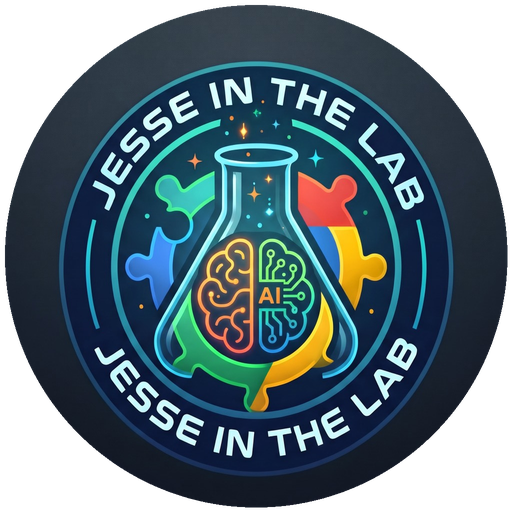
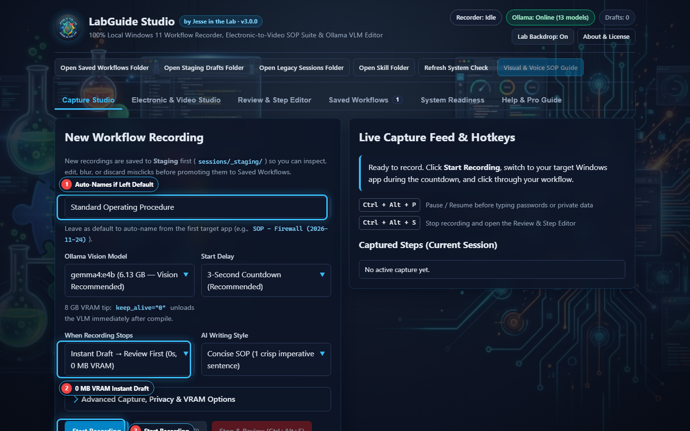
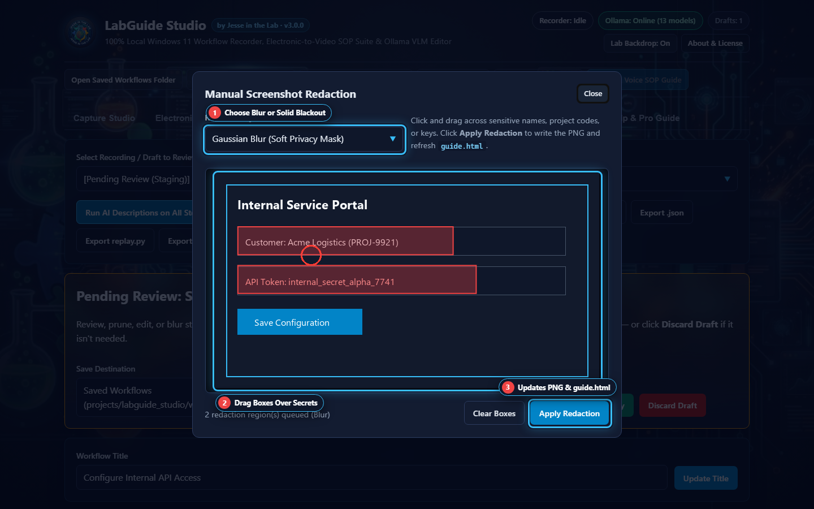
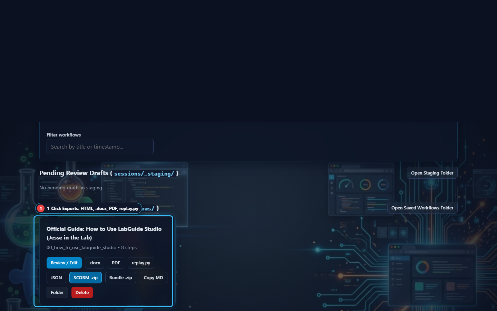

<div align="center">



# 🧪 LabGuide Studio (v3.0.0)

**100% Local Windows 11 Workflow Recorder • Electronic-to-Video SOP Suite • Kokoro-82M CPU Narration • Local Ollama VLM Compiler**

[](https://github.com/jesusdelira7-956/LabGuide-Studio/actions)
[](https://buymeacoffee.com/JesseInTheLab)

[](https://microsoft.com)
[](https://python.org)
[](PRIVACY.md)
[](PRIVACY.md)
[](LICENSE)

</div>

---

**LabGuide Studio** by **Jesse in the Lab** turns live Windows 11 clicks, form typing, and written runbooks into polished, annotated Standard Operating Procedures, `.mp4` narrated walkthroughs, ISO compliance packets, and SCORM 1.2 LMS courses — **without sending a single screenshot, keystroke, or audio track to the cloud**.

> [!NOTE]
> **Our Mission:** Give engineers, IT teams, and educators a private, zero-subscription documentation studio that respects your hardware, keeps credentials and internal UIs on your own disk, and works seamlessly with local Ollama vision models or offline UIA fallbacks.

---

## ⚡ Why LabGuide Studio Instead of Cloud SOP Recorders?

| Capability | Cloud SaaS SOP Recorders | 🧪 LabGuide Studio (v3.0.0) |
| :--- | :---: | :---: |
| **Data Residency & Privacy** | Uploads every screenshot & text snippet to external SaaS servers | **100% Localhost Execution** (`127.0.0.1:8897` + local SQLite + local Ollama) |
| **Draft Cleanup & Misclicks** | Often compiles everything immediately | **Staging-First Workflow** (`sessions/_staging/`) — reorder, edit, blur, or discard before saving |
| **Passwords & Sensitive UI** | Manual post-edit only | **Password-Aware Coalescer (`••••••••`) + CPU RapidOCR Redaction + Blur/Blackout Canvas** |
| **Video Narration & Presenters** | Paid per-seat SaaS tier + cloud voice licensing | **CPU Kokoro-82M ONNX Neural TTS (0 MB VRAM) + Consent-Gated PiP Avatars + `.srt` + `zoompan`** |
| **Document-to-Video SOPs** | Separate manual slide tool | **Built-in Importer** (`.md`, `.txt`, `.docx`, `.pdf`) &rarr; `1920x1080` branded slides + MP4 walkthrough |
| **Training & Compliance Exports** | Vendor-locked links | **Self-Contained `.html`, `.md`, Word `.docx`, Print PDF, SCORM 1.2 `.zip`, Offline `.zip`, `replay.py`** |
| **8 GB GPU Headroom** | N/A | **CPU TTS/OCR/FFmpeg (`0 MB` VRAM)** + Ollama **`keep_alive="0"`** instant VRAM unload |

---

## 📸 Studio Screenshots

<div align="center">

| Capture Studio (Jesse in the Lab UI) | Manual Blur & Blackout Canvas | Saved Workflows & Multi-Format Exports |
| :---: | :---: | :---: |
|  |  |  |

</div>

---

## ☕ Support the Project

If **LabGuide Studio** saves you hours writing SOPs, internal runbooks, or training videos:

[](https://buymeacoffee.com/JesseInTheLab)

👉 **[buymeacoffee.com/JesseInTheLab](https://buymeacoffee.com/JesseInTheLab)**

---

## 🚀 Easy Installation & Launch Options

### 🥇 Option 1: 1-Click Windows Installer (`Install.cmd`) — Desktop Shortcut Included
1. Clone or download this repository:
   ```powershell
   git clone https://github.com/jesusdelira7-956/LabGuide-Studio.git
   cd LabGuide-Studio
   ```
2. Double-click **`Install.cmd`** (requires Python 3.11+).
   - Creates `.venv`, installs dependencies from `requirements.txt`, creates the **LabGuide Studio** Desktop shortcut (`LabGuide Studio.lnk`) with the **Jesse in the Lab** icon, runs dependency checks, and offers to launch immediately.

### 🥈 Option 2: Double-Click Runner (`Run_LabGuide_Studio.bat` / Desktop Shortcut)
Double-click **LabGuide Studio** on your Desktop or run `Run_LabGuide_Studio.bat` (or `.\launch_labguide.ps1` in PowerShell). The bootstrapper [`launcher.py`](launcher.py) automatically:
1. Enables Windows 11 **Per-Monitor V2 DPI awareness** (`SetProcessDpiAwareness(2)`).
2. Starts local **`ollama serve`** in the background if installed and offline.
3. Locates **FFmpeg** on `PATH` or WinGet Packages for video compositing.
4. Verifies **Kokoro-82M ONNX** voices and the 3 consent-safe Studio avatars.
5. Opens the Studio UI at `http://127.0.0.1:8897` (or focuses an already-running session).

### 🥉 Option 3: Developer & CLI Automation Mode
```powershell
# Check all system dependencies (JSON summary)
python launcher.py --check-only --no-auto-install

# Record directly from CLI to Staging
python labguide_engine.py record --title "Configure Windows Firewall" --model gemma4:e4b --out sessions/_staging

# Re-compile an existing session with a different prompt style
python labguide_engine.py compile --session workflows/<workflow_id> --model gemma4:e4b --style detailed
```

---

## ✨ Key Features

- **Per-Monitor V2 DPI & Non-Blocking Hooks**: Uses `SetProcessDpiAwareness(2)`, non-blocking `pynput` callbacks backed by `queue.Queue`, and `UIAutomationInitializerInThread()` so Windows 11 never drops low-level hooks.
- **Self-Click Exclusion & Screenshot-Hidden Mini-HUD**: Automatically ignores clicks on `LabGuide Studio` and floats an always-on-top Mini-HUD protected by Windows `WDA_EXCLUDEFROMCAPTURE`.
- **Smart Input Coalescing & PII Auto-Redaction**: Groups continuous form typing into a single step, masks password/secret/token fields as `••••••••`, and blurs sensitive OCR detections locally on CPU (`RapidOCR`).
- **Electronic SOP Importer**: Parses `.md`, `.txt`, `.docx`, `.pdf`, or pasted instructions via local Ollama (`gemma4:e4b`) or deterministic parser into branded `1920x1080` slides.
- **CPU Neural Video Producer**: Synthesizes Kokoro-82M voices (`af_heart`, `af_sarah`, `af_bella`, `am_adam`, `am_michael`, `bf_emma`, `bm_george` + Windows SAPI fallback) with `[pause Xs]` tags, smooth FFmpeg `zoompan`, burned-in `.srt` captions, and consent-verified PiP avatars.
- **Enterprise & LMS Deliverables**: ISO Document Control headers, interactive 3-question Knowledge Check quizzes, standalone Base64 HTML, Markdown, Word `.docx`, Print PDF, Offline Bundle `.zip`, SCORM 1.2 LMS `.zip`, and executable UIA `replay.py` scripts.

---

## 📂 Repository Structure

```text
LabGuide-Studio/
├── .github/                  # CI workflow, FUNDING.yml, Issue & PR templates
├── assets/
│   ├── avatars/              # Built-in consent-safe synthetic presenters & manifest.json
│   ├── brand/                # Jesse in the Lab transparent circular logo & wallpaper
│   └── labguide_studio.ico   # Multi-resolution Windows Desktop shortcut icon
├── docs/screenshots/         # Verified Web UI screenshots
├── tests/                    # Offline unittest suite (zero-warning strict mode)
├── ui/                       # Glassmorphic Web UI (HTML, CSS, Vanilla JS + <dialog>)
├── brand.py                  # Dual-mode path resolver, About/License payload & artwork builder
├── build_official_sop.py     # Automated live-UI walkthrough & video SOP builder
├── create_desktop_shortcut.py# WScript.Shell COM .lnk Desktop shortcut installer
├── exporter.py               # HTML, MD, Base64 MD, DOCX, PDF, SRT, Offline ZIP, SCORM 1.2, replay.py
├── Install.cmd               # 1-click Windows venv, dependency & shortcut installer
├── labguide_engine.py        # Multi-threaded Windows 11 capture, UIA, OCR & VLM engine
├── launch_labguide.ps1       # PowerShell launcher wrapper
├── launcher.py               # Dependency bootstrapper (Ollama, FFmpeg, Kokoro, .venv)
├── mini_hud.py               # Floating screenshot-excluded tkinter Mini-HUD
├── presenter_engine.py       # Lip-synced PiP avatar renderer & consent provenance ledger
├── Run_LabGuide_Studio.bat   # 1-click Windows Studio runner
├── session_manager.py        # Staging workflow CRUD, ISO controls, quiz generator & path jail
├── sop_importer.py           # .md / .txt / .docx / .pdf parser & 1080p slide composer
├── tts_engine.py             # Kokoro-82M CPU ONNX + SAPI synthesizer & SRT generator
├── video_studio.py           # Zoom-to-click FFmpeg composer & single-step cache re-renderer
├── web_server.py             # Loopback HTTP server (127.0.0.1:8897)
├── AGENTS.md                 # Windows 11 architecture & VRAM guardrails
├── CHANGELOG.md              # Release history
├── CODE_OF_CONDUCT.md        # Community standards
├── CONTRIBUTING.md           # Developer setup & verification gates
├── LICENSE                   # MIT License (© 2026 Jesse in the Lab)
├── PRIVACY.md                # 100% local execution & zero-telemetry guarantee
├── requirements.txt          # Python dependencies
├── SECURITY.md               # Threat model & security controls
└── THIRD_PARTY_LICENSES.md   # Open-source notices & attributions
```

---

## 🧪 Verification & Testing

Run the complete test suite with strict deprecation and resource-leak checks:

```powershell
python -W error::DeprecationWarning -W error::ResourceWarning -m unittest discover -s tests -v
```

Validate individual modules against static security & syntax gates when working inside an Antigravity workspace.

---

## 📜 License & Privacy Notice

- **License**: Released under the [MIT License](LICENSE) — Copyright © 2026 **Jesse in the Lab**.
- **Third-Party Notices**: Full open-source attributions live in [THIRD_PARTY_LICENSES.md](THIRD_PARTY_LICENSES.md).
- **Privacy & Security**: Read [PRIVACY.md](PRIVACY.md) and [SECURITY.md](SECURITY.md) for the complete local-only guarantee and path-jail architecture.
